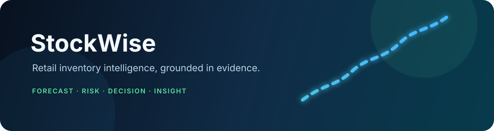

<div align="center">
  

  <p>
    <strong>Evidence-backed inventory intelligence for modern retail teams.</strong><br>
    Deterministic analytics first. Local AI explanations where they add value.
  </p>

  <p>
    <a href="#what-it-does">What it does</a> ·
    <a href="#architecture">Architecture</a> ·
    <a href="#quick-start">Quick start</a> ·
    <a href="#configuration">Configuration</a>
  </p>

  
  
  
  
</div>

## What it does

StockWise combines forecasting, inventory-risk analysis, scenario optimization, and
local AI interpretation in one full-stack application.

- **Forecasting** — baseline, interval, WRMSSE, LightGBM, and XGBoost evaluation paths.
- **Inventory intelligence** — stockout, overstock, expiry, purchasing, markdown, and policy scenarios.
- **Multi-agent analysis** — Supervisor, Forecast, Inventory Risk, Decision, and Business Intelligence agents orchestrated with LangGraph.
- **Safe AI integration** — Ollama/Qwen structured outputs are treated as qualitative, untrusted content; deterministic values remain authoritative.
- **Operational API** — FastAPI, PostgreSQL, Alembic migrations, background jobs, and a narrow authenticated integration gateway.
- **Frontend workspace** — Next.js dashboards for overview, forecast lab, risk explorer, investigations, decision lab, approvals, and workflow visibility.

> **Design principle:** the model explains saved evidence; it does not calculate,
> approve purchases, change inventory, or replace validated business logic.

## Architecture

```text
Next.js frontend
        │
        ▼
FastAPI backend ─── PostgreSQL + Alembic
        │
        ├── Forecasting and inventory analytics
        ├── LangGraph investigation workflow
        ├── Ollama / Qwen qualitative explanations
        └── Authenticated integration gateway
```

| Directory | Purpose |
|---|---|
| [`frontend/`](./frontend) | Next.js application and dashboards |
| [`backend/api/`](./backend/api) | FastAPI routes, settings, auth, and integrations |
| [`backend/agent/`](./backend/agent) | Supervisor, specialist agents, validation, and Ollama client |
| [`backend/forecasting/`](./backend/forecasting) | Forecast models, features, metrics, and evaluation |
| [`backend/persistence/`](./backend/persistence) | SQLAlchemy models and database operations |
| [`backend/simulation/`](./backend/simulation) | Risk, purchasing, markdown, and policy scenarios |
| [`alembic/`](./alembic) | Database migrations |

## AI system

StockWise uses AI as a controlled interpretation layer over validated retail
evidence. The core calculations remain deterministic and auditable.

### Four-agent workflow

```text
Question
   │
   ▼
Supervisor ── selects approved evidence domains
   │
   ├── Forecast Intelligence ── saved forecast and evaluation evidence
   ├── Inventory Risk ──────── stockout, overstock, and expiry evidence
   ├── Decision Intelligence ─ saved purchasing and policy scenarios
   └── Business Intelligence ─ cross-domain synthesis
            │
            ▼
     Validated qualitative findings
```

The four specialists have separate prompts and response contracts:

1. **Forecast Intelligence** explains saved forecast behavior, model comparisons,
   uncertainty, and data limitations.
2. **Inventory Risk** interprets stockout, overstock, coverage, and expiry-risk
   evidence without inventing inventory facts.
3. **Decision Intelligence** explains saved purchasing, budget, markdown, and
   policy scenarios while keeping numerical values tied to source evidence.
4. **Business Intelligence** synthesizes completed specialist findings across
   domains and identifies disagreements or missing inputs.

### LangGraph orchestration

LangGraph coordinates the investigation as a bounded state graph:

1. The **Supervisor** routes the question or uses a conservative deterministic
   route when model classification is unavailable.
2. Approved evidence is loaded from saved forecast, risk, and decision sources.
3. Evidence passes schema, numeric, and reference validation before reaching an agent.
4. Specialist nodes run sequentially or in the configured parallel mode.
5. The Business Intelligence node runs after the specialist barrier when
   cross-domain synthesis is requested.
6. Final answers combine deterministic report values with accepted qualitative
   findings, while failed nodes produce safe fallback output.

This keeps orchestration observable and bounded: no agent receives unrestricted
tool access, and no model response can authorize a purchase, inventory change,
approval, or live price update.

### Local LLM integration

- Runs locally through **Ollama**, using models such as `qwen3.5:4b`.
- Uses Ollama `/api/chat` with non-streaming structured JSON output.
- Sends bounded, sanitized evidence packets rather than unrestricted database access.
- Validates model responses with Pydantic schemas before accepting them.
- Rejects unsupported evidence references, numeric claims in qualitative prose,
  malformed JSON, incomplete output, and unsafe responses.
- Records bounded inference telemetry without persisting raw prompts or secrets.

If Ollama is unavailable, disabled, times out, or produces invalid output,
StockWise falls back to deterministic summaries. Numeric values, citations,
scenario results, and operational constraints always come from validated saved
evidence—not from model-generated text.

## Quick start

### Requirements

- Docker Desktop with Compose
- Git
- At least 4 GB available memory for the default stack
- Optional: Ollama with `qwen3.5:4b` for local AI explanations
- Optional: Python 3.12 and Node.js 22 for local development

### Run with Docker

```powershell
git clone https://github.com/amruthssss/Stock_AI.git
cd Stock_AI
Copy-Item .env.example .env
# Set POSTGRES_PASSWORD in .env
docker compose up --build
```

Open:

- Frontend: <http://127.0.0.1:3000>
- API docs: <http://127.0.0.1:8000/docs>
- API readiness: <http://127.0.0.1:8000/api/v1/health/ready>

### Local development

```powershell
python -m venv .venv
.\.venv\Scripts\Activate.ps1
pip install -r requirements.txt

cd frontend
npm ci
npm run dev
```

The backend entry point is:

```text
backend.api.main:app
```

## Configuration

Copy [`.env.example`](./.env.example) to `.env`. Never commit `.env` or credentials.

Important settings:

| Variable | Purpose |
|---|---|
| `POSTGRES_PASSWORD` | Required local database password |
| `STOCKWISE_LLM_ENABLED` | Enables optional local Ollama explanations |
| `STOCKWISE_OLLAMA_BASE_URL` | Ollama endpoint, such as `http://ollama:11434` in Compose |
| `STOCKWISE_OLLAMA_MODEL` | Installed model name, such as `qwen3.5:4b` |
| `STOCKWISE_LLM_TIMEOUT_SECONDS` | Bounded local-model request timeout |
| `STOCKWISE_APPROVAL_ADMIN_TOKEN` | Optional token for approval-write routes |

Ollama is optional. When it is disabled, unavailable, or returns unsafe output,
StockWise keeps the deterministic evidence-backed fallback.

## Validation and scope

This repository contains the application source and runtime configuration needed
to understand and run StockWise. Local datasets, generated reports, model
weights, credentials, backups, and development-only artifacts are intentionally
not included.

The application does not claim autonomous purchasing, inventory adjustment, or
live price changes. RAG is not presented as a feature unless a retrieval path is
actually used; saved database evidence and deterministic report readers are the
source of truth for investigations.

## License

No license has been selected yet. Add a license before treating this repository
as reusable open-source software.
